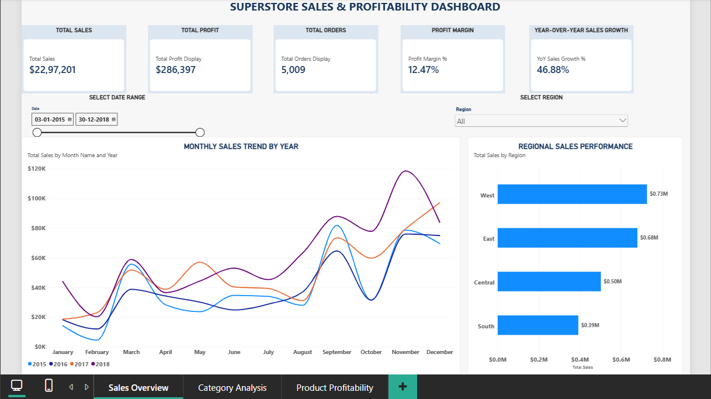
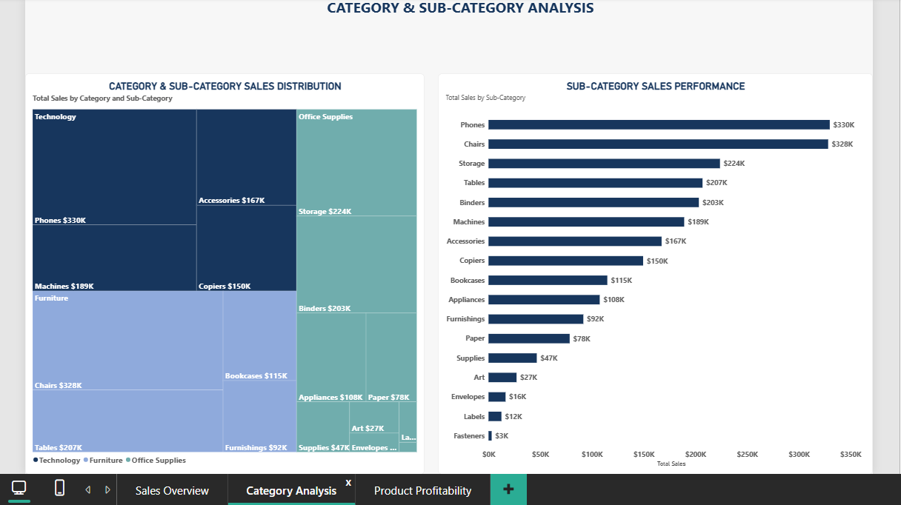
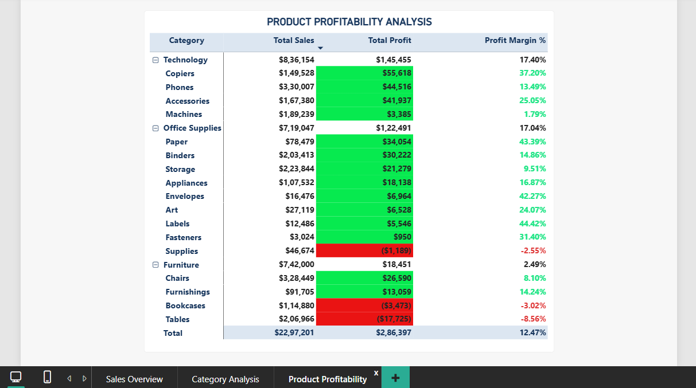

# Superstore Sales & Profitability Dashboard

## 1. Project Overview

This project focuses on analysing Superstore sales and profitability data using Microsoft Power BI.

The objective is to transform raw sales data into meaningful business insights through data cleaning, data modelling, DAX calculations and interactive visualisation.

The dashboard helps understand sales performance, regional contributions, product category trends and profitability.

## 2. Tools & Technologies

- Microsoft Power BI
- Power Query
- DAX (Data Analysis Expressions)
- Data Modelling
- Data Visualisation

## 3. Dashboard Pages

### Page 1 – Sales Overview

Provides an executive summary of business performance.

**Key Performance Indicators:**
- Total Sales: $2,297,201
- Total Profit: $286,397
- Total Orders: 5,009
- Profit Margin: 12.47%
- Year-over-Year Sales Growth: 46.88%

**Visualisations:**
- Monthly Sales Trend by Year
- Regional Sales Performance
- Date Range Slicer
- Region Slicer

### Page 2 – Category & Sub-Category Analysis

Explores sales distribution across product categories and sub-categories.

**Visualisations:**
- Category and Sub-Category Sales Distribution (Treemap)
- Sub-Category Sales Performance (Bar Chart)

Highlights top-selling sub-categories, including Phones, Chairs and Storage.

### Page 3 – Product Profitability Analysis

Evaluates product-level profitability using an expandable matrix.

**Metrics analysed:**
- Total Sales
- Total Profit
- Profit Margin Percentage

Conditional formatting highlights profitable and loss-making sub-categories.

Examples of loss-making sub-categories include Tables, Bookcases and Supplies.

## 4. Key Business Insights

- The West region recorded the highest sales, followed by the East region.
- Phones and Chairs were among the leading sub-categories by sales.
- Copiers generated the highest sub-category profit.
- Tables recorded a significant loss despite generating substantial sales.
- The overall profit margin was 12.47%.
- Monthly sales trends showed recurring peaks during March, September and November.

## 5. Interactive Features

- Date Range filtering.
- Region-based filtering.
- Synchronized slicers across all three dashboard pages.
- Expandable Category and Sub-Category hierarchy.
- Conditional formatting for profitability analysis.

## 6. Project Files

- `Superstore.pbix` – Interactive Power BI dashboard.
- `SuperStore.pdf` – Exported three-page dashboard report.

## 7. Conclusion

This project demonstrates how Power BI can be used to analyse business performance, identify sales trends, evaluate regional contributions and uncover product profitability issues.

The dashboard converts raw business data into actionable insights that can support data-driven decision-making.

## Dashboard Screenshots

### 1. Sales Overview

### 2. Category Analysis

### 3. Product Profitability

